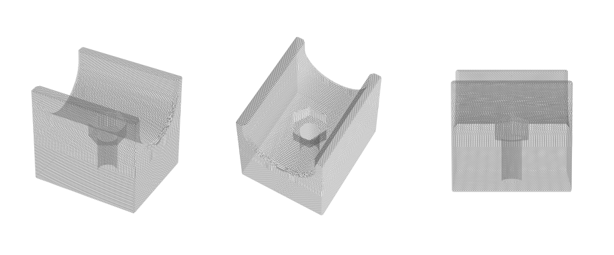

# Pipe-guide bracket

Printed brackets that bolt to the sides of a freETarget **Competition** target and loosely cup the
1" steel-pipe uprights of the target stand, so the target can't twist while it is raised and lowered.



## The target and the stand

**Target.** The standard freETarget Competition housing, built from the project's drawings with no
changes (FRE-007 right and FRE-008 left side panels, github.com/ten-point-nine/freETarget):

- Outside width 304 mm (11.97"), across the two side panels.
- Side panels: 12 mm plywood, 460 mm tall × 106 mm deep. The left panel carries the door hinges.
- Each side panel has two Ø10 mm through-holes, 250 mm apart vertically, 50 mm from one long edge and 56 mm from the other.
  The brackets bolt through these holes.

**Stand.** A wooden base with two 1" steel floor flanges; a 6' length of 1" pipe rises from each flange,
and a 12" length of 1" pipe joins their tops with two 1" 90° elbows. The inside-to-inside distance
between the uprights is about 14.5". The target hangs between the uprights and is raised and lowered
between them.

**What the brackets do.** Two brackets per side, one at each side hole. Each has a U that cups the pipe
loosely: the target can slide freely up and down, but it can't swing or rock between the uprights.

## Fit and clearances

| | |
|---|---|
| Pipe | 1" NPS steel, 33.4 mm (1.315") outside diameter |
| Pipe spacing designed to | 14.4" inside to inside (stands measure ≈14.5") |
| Side-to-side play | ≈1.3 mm per side at 14.5" |
| Front/back play | 2.3 mm per side (U is 38 mm wide) |
| Ends of the U | 2 mm 45° lead-in, so the bracket can't catch on the pipe |
| Bracket size | 60 tall × 50 deep × 56 mm out from the panel |
| Hinge clearance | Bracket is centred on the holes, so it stays ≈25 mm in from one edge of the side panel and 31 mm from the other. The door still opens 90°. |

Keep the target's travel within the straight pipe: the brackets don't pass the floor flanges or the
top elbows.

## Two versions

The pocket in the floor of the U traps either the bolt head or the nut, so it can't spin while you
tighten the other end from inside the box. Choose one.

### Captured bolt: `captured-bolt/`

The bolt head sits in the bracket; you tighten the nut inside the box.

Per bracket (4 needed):
- M10 × 55 hex-head bolt (fully or partially threaded)
- M10 flat washer
- M10 nylon-insert lock nut (about 8 mm of bolt sticks out past it)

To fit: drop the bolt into the hex pocket from the U side, push it through the side hole, then put the
washer and lock nut on inside the box. A piece of tape over the head keeps the bolt in while you do this.

### Captured nut: `captured-nut/`

The nut sits in the bracket; you tighten the bolt head inside the box.

Per bracket (4 needed):
- M10 × 40 hex-head bolt
- M10 flat washer, under the head inside the box
- Plain M10 hex nut (8 mm tall), pressed into the pocket
- A split lock washer under the head, or a drop of blue threadlocker on the bolt tip (keep it off the PLA)

To fit: press the nut into the pocket, then feed the bolt from inside the box through the side hole and
into the nut. With the washer, the bolt tip ends ≈5 mm below the floor of the U, clear of the pipe.
Don't use a nylon-insert nut here: it's taller, and the bolt would have to come too close to the pipe to
lock it. Bolt lengths that work run from about 37.5 to 43 mm; × 35 catches too few threads and × 45
reaches the pipe.

Both pockets fit a 17 mm (DIN 933/934) or 16 mm (ISO 4017/4032) M10 hex.

**Tighten lightly in both versions.** The pipes keep the brackets aligned; a heavy clamp only makes PLA creep.

## Printing

Download the STL for your version from `captured-bolt/` or `captured-nut/`.

| File | Print | Bed needed |
|---|---|---|
| `…_print_x4.stl` | 4 | 60 × 50 mm each; all four fit on a 200 × 220 mm bed |
| `…_onepiece_print_x2.stl` | 2 (one per side, spanning both holes) | 310 mm or more |

- PLA is fine indoors. It softens around 55 °C, so keep it out of hot cars and direct sun.
- Flat face down, U facing up. No supports.
- 0.2 mm layers, 4 walls, 30–40 % infill.
- Print one first and check its fit on the pipe and its clearance from the hinge.

## Building the STLs

The STLs are built from `source/FET_pipe_guide.scad`. After changing the source, rebuild them and commit the source and the STLs together so they stay in step.

```sh
./build-stls.sh
```

This writes all four STL files into `captured-bolt/` and `captured-nut/`. It needs `openscad` on your
PATH; on a Mac the app's binary is `/Applications/OpenSCAD.app/Contents/MacOS/OpenSCAD`.

To change the design, edit the settings at the top of `FET_pipe_guide.scad`: pipe size, clearance,
pipe spacing, bolt size, bracket height and so on. Then run the script again. `NUT_TRAP` and
`ONE_PIECE` choose the version. The four small files in `source/` (`captured_bolt_print_x4.scad`
and so on) open a single version in OpenSCAD with those two settings already made.
