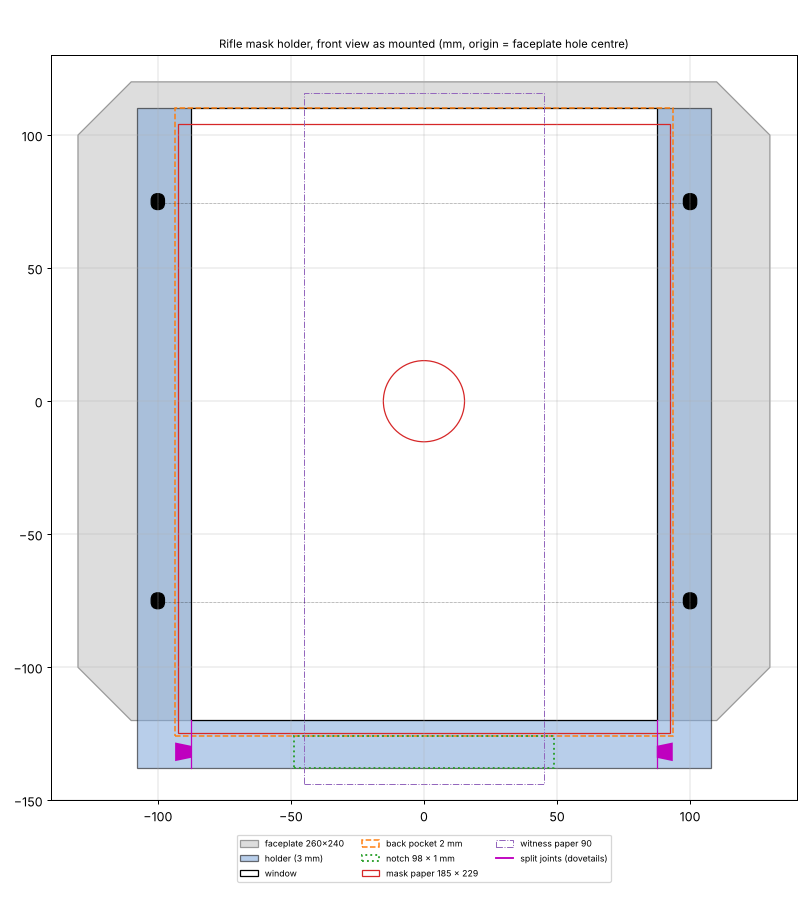

# Rifle mask holder

A printed frame that holds a 185 × 229 mm (7.25" × 9") paper mask over the freETarget rifle
faceplate. The mask's 30.5 mm hole sits concentric with the faceplate hole, and the witness paper runs
between the mask and the faceplate and out under the crossbar. It's a larger version of the community
"Rifle Target Holder v17", with the same pocket depth and the same witness-paper notch.



## How it fits

- **Mask:** 185 wide × 229 tall. The hole's top edge is 89 mm from the top of the paper and its
  sides 77.25 mm from each edge, so the hole centre is 104.25 mm from the top and 92.5 mm from each side.
  The holder places that centre on the faceplate hole.
- **Frame:** 216 × 248 mm, 3 mm thick. It's a U, open at the top, with the crossbar at the bottom.
  The frame overlaps the mask by 5 mm on the sides and bottom; the top of the mask is open, like v17.
- **Pocket (back):** 187 mm wide × 2 mm deep, 1 mm clearance around the mask. Mask and witness paper
  both sit in it.
- **Witness-paper notch:** 98 mm wide × 1 mm deep through the back of the crossbar, for the 90 mm paper.
- **Screws:** four slots at the faceplate's #8-32 screw holes (Ø5 at x = ±100 mm, y = +74.5 / −75.5 mm
  from the hole centre). Each slot is 1 mm long, so the holder fits whichever way up the faceplate is
  mounted. The holder adds 3 mm to the stack, so the faceplate's #8-32 × 1-3/8" screws may need to
  become 1-1/2" to keep full thread in their nuts.
- **Below the faceplate:** the mask runs 4.75 mm past the faceplate's bottom edge, so the crossbar
  sits just below the plate.

## Which files to print

| Folder | Pieces | Bed needed |
|---|---|---|
| `onepiece/` | 1 | About 220 × 250 mm (part is 216 × 248) |
| `split-3-piece/` | Left leg, right leg, crossbar | 200 × 220 mm. The legs come laid on a 45° diagonal (≈190 × 190 mm); print them one at a time |

**Assembling the split version:** the crossbar's dovetails press into the legs from the front. Glue
them with CA (super glue): the crossbar hangs below the faceplate, so nothing behind it holds the joint
in place.

## Printing (PLA)

- Front face down; the pocket and notch face up. No supports.
- 0.2 mm layers, 3–4 walls, 20–30 % infill. The lips over the mask are 1 mm thick, so 0.2 mm layers
  give them 5 layers.
- Check the first print for paper fit: if the mask binds in the pocket, raise `PAPER_CLR`.

## Building the STLs

```sh
./build-stls.sh
```

The STLs are built from `source/FET_rifle_mask_holder.scad`; after changing the source, rebuild and
commit the source and STLs together. All dimensions are settings at the top of the file (mask size and
hole position, pocket and notch, lip, crossbar height, screw positions, dovetail size and fit).
`PIECE = "assembly"` shows the three split pieces assembled, for checking in OpenSCAD.
