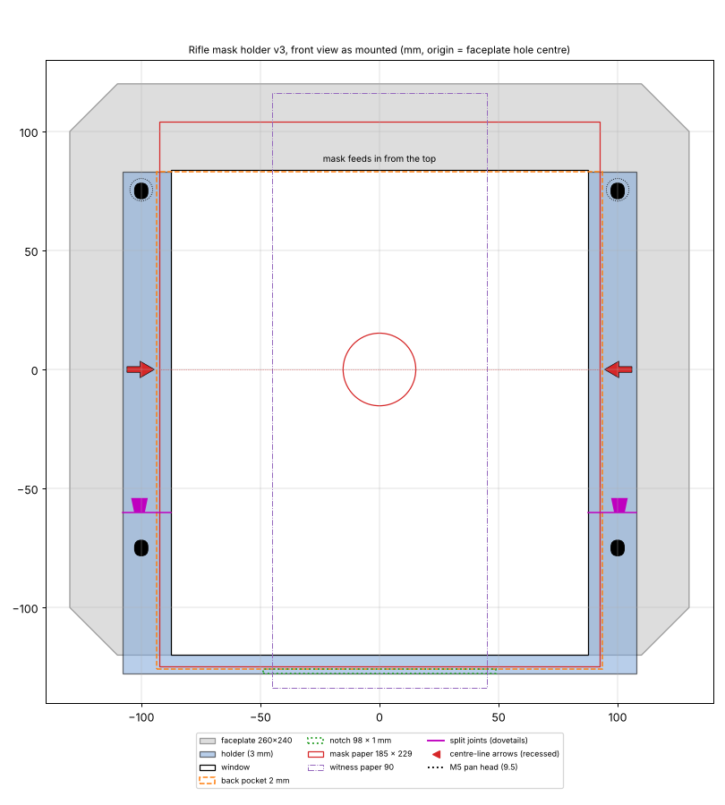

# Rifle mask holder

A printed frame that holds a 185 × 229 mm (7.25" × 9") paper mask over the freETarget rifle
faceplate. The mask's 30.5 mm hole sits concentric with the faceplate hole, and the witness paper runs
between the mask and the faceplate and out under the crossbar. It's a larger version of the community
"Rifle Target Holder v17", with the same pocket depth and the same witness-paper notch.



## How it fits

- **Mask:** 185 wide × 229 tall. The hole's top edge is 89 mm from the top of the paper and its
  sides 77.25 mm from each edge, so the hole centre is 104.25 mm from the top and 92.5 mm from each side.
  The holder places that centre on the faceplate hole.
- **Frame:** 216 × 211 mm, 3 mm thick. It's a U, open at the top, with the crossbar at the bottom.
  The frame overlaps the mask by 5 mm on the sides and bottom.
- **Open top:** the legs stop 3 mm above the top screw heads (83 mm above the hole centre), so a mask
  can be slid in from the top past the target's paper guide. The top 21 mm of the mask isn't held.
- **Crossbar:** 8 mm tall: the 5 mm lip over the mask (1 mm thick) and a 2 mm full-thickness strip
  below it. It stops 7.75 mm below the faceplate so it clears the paper-feed frame.
- **Centre-line arrows:** two arrows recessed 0.6 mm into the front of the legs point at the
  horizontal centre line of the mask hole. Line the hole up with them when you put in a new mask.
  They're recessed, not raised, because the holder prints front face down.
- **Pocket (back):** 187 mm wide × 2 mm deep, 1 mm clearance around the mask. Mask and witness paper
  both sit in it.
- **Witness-paper notch:** 98 mm wide × 1 mm deep through the back of the crossbar, for the 90 mm paper.
- **Screws:** four 5.5 mm slots at the faceplate's screw holes (x = ±100 mm, y = +74.5 / −75.5 mm from
  the hole centre): clearance for M5 screws (pan heads with a 3 mm hex socket). Each slot is 1 mm
  longer than wide, so the holder fits whichever way up the faceplate is mounted. The holder adds 3 mm
  to the stack, so the faceplate screws may need to be 3 mm longer to keep full thread.
- **Below the faceplate:** the mask runs 4.75 mm past the faceplate's bottom edge, so the crossbar
  sits just below the plate.

## Which files to print

| Folder | Pieces | Bed needed |
|---|---|---|
| `onepiece/` | 1 | About 220 × 215 mm (part is 216 × 211) |
| `split-3-piece/` | Crossbar, left leg, right leg | 200 × 220 mm; all three fit at once (crossbar 216 × 74, legs 21 × 143) |

**Assembling the split version:** the pieces part 60 mm below the hole centre, between the screws, so
the crossbar carries both lower screws and each leg carries one upper screw. The crossbar's dovetails
press into the legs from the front; the screws hold everything in place, so glue is optional.

## Printing (PLA)

- Front face down; the pocket and notch face up. No supports.
- 0.2 mm layers, 3–4 walls, 20–30 % infill. The lips over the mask are 1 mm thick, so 0.2 mm layers
  give them 5 layers.
- Check the first print for paper fit: if the mask binds in the pocket, raise `PAPER_CLR`.

## Building the STLs

```sh
./build-stls.sh
```

The STLs are built from `source/FET_rifle_mask_holder.scad`; after changing the source, rebuild and
commit the source and STLs together. All dimensions are settings at the top of the file (mask size and
hole position, pocket and notch, lip, crossbar height, screw positions, dovetail size and fit).
`PIECE = "assembly"` shows the three split pieces assembled, for checking in OpenSCAD.
